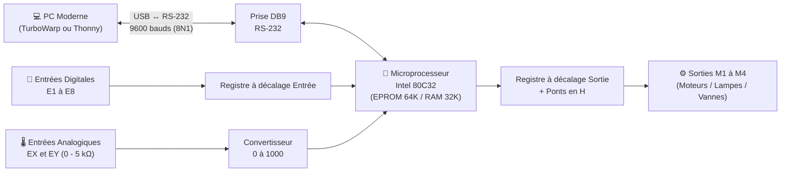

# 🧱 fischertechnik 30 402 — Kit Moderne Scratch (TurboWarp) & Python (Thonny)

> **Ressource pédagogique Open-Source (CoderDojo)** pour redonner vie à la mythique interface robotique **fischertechnik Intelligent Interface (Réf. `30 402`, 1993)** sur les ordinateurs modernes, en **programmation par blocs (TurboWarp / Scratch 3)** via Web Serial et en **Python (Thonny)**.

---

## 📦 Contenu du dépôt

| Fichier | Description |
| :--- | :--- |
| [`ft30402_turbowarp.js`](./ft30402_turbowarp.js) | **Extension Scratch / TurboWarp** autonome (utilise l'API *Web Serial* du navigateur, zéro installation). |
| [`ft30402.py`](./ft30402.py) | **Bibliothèque Python** avec thread d'arrière-plan intégré et commandes en français pour **Thonny**. |
| [`exemple_thonny.py`](./exemple_thonny.py) | Script de démarrage rapide pour Thonny (commutateur télérupteur `E1` $\rightarrow$ LED en `M2`). |
| [`exemples/tableau_de_bord_30402.sb3`](./exemples/tableau_de_bord_30402.sb3) | **Projet TurboWarp `.sb3` clé en main** avec tableau de bord graphique IHM, voyant `E1` et jauges temps réel. |
| [`exemples/01_telerupteur_led.py`](./exemples/01_telerupteur_led.py) | Projet Python Niv. 1 : Commutateur d'éclairage (Télérupteur avec anti-rebond). |
| [`exemples/02_barriere_automatique.py`](./exemples/02_barriere_automatique.py) | Projet Python Niv. 2 : Barrière de parking automatisée avec fins de course et sécurité optique. |
| [`exemples/03_espion_protocole_binaire.py`](./exemples/03_espion_protocole_binaire.py) | Outil pédagogique : Visualiseur temps réel des octets binaires échangés sur le câble RS-232. |
| [`exemples/04_tableau_de_bord_ihm.py`](./exemples/04_tableau_de_bord_ihm.py) | **Fenêtre graphique IHM en Python (Tkinter)** : poste de contrôle complet (`M1..M4`, voyants `E1..E8`, jauges `EX`/`EY` et espion binaire). |
| [`docs/FICHE_MEMO_ATELIER.md`](./docs/FICHE_MEMO_ATELIER.md) | **Fiche Mémo Recto-Verso CoderDojo** (et sa version prête à imprimer [`docs/fiche_memo_imprimable.html`](./docs/fiche_memo_imprimable.html)). |

---

## 🔍 1. Présentation du matériel : L'Intelligent Interface `30 402`

Sortie au début des années 1990, l'**Intelligent Interface (Réf. `30 402`)** possède un boîtier transparent emblématique qui laisse voir toute son architecture électronique :

### Architecture interne
* **Microprocesseur :** **Intel 80C32** (`TS80C32X2`, famille MCS-51 / 8051).
* **Mémoires :**
  * **EPROM (64 Ko) :** Contient le système d'exploitation temps réel gravé en usine.
  * **SRAM (32 Ko, `HY62256`) :** Mémoire vive de travail.
* **Registres à décalage internes (`74HC`) :**
  * Un registre à décalage d'entrée capture simultanément les 8 capteurs `E1..E8`.
  * Un registre à décalage de sortie pilote les 4 ponts en H des sorties moteurs `M1..M4`.



---

### Disposition du bornier d'Entrées / Sorties (Façade droite)

Sur la tranche droite du boîtier se trouvent **16 colonnes de 2 douilles superposées** (au format fiches bananes 2,6 mm fischertechnik). Chaque composant se branche simplement **verticalement** (une fiche dans le trou du haut, une fiche dans le trou du bas de la même colonne) :

```text
+-----------------------------------------------------------------------------------+
|  9V=... |  ⊥   | E1 | E2 | EX | EY | E3 | E4 | E5 | E6 | E7 | E8 | M1 | M2 | M3 | M4 |
|    O    |  O   | O  | O  | O  | O  | O  | O  | O  | O  | O  | O  | O  | O  | O  | O  |  <- Rangée Haut
|    O    |  O 🔴| O  | O  | O  | O  | O  | O  | O  | O  | O  | O  | O  | O  | O  | O  |  <- Rangée Bas
+-----------------------------------------------------------------------------------+
```

* **`M1` à `M4` (4 sorties bidirectionnelles 9V) :**
  * Pour brancher **4 moteurs** (avant / arrière / arrêt / frein), ou des **lampes**, **LEDs**, **électroaimants** et **électrovannes**.
  * Courant nominal : `250 mA` en continu par sortie (`1 A` max en crête), avec protection intégrée contre les courts-circuits.
* **`E1` à `E8` (8 entrées numériques tout-ou-rien) :**
  * Pour brancher des **boutons-poussoirs** (fins de course), **contacts magnétiques Reed**, ou **phototransistors** (barrières lumineuses).
* **`EX` et `EY` (2 entrées analogiques de résistance `0 à 5 kΩ`) :**
  * Pour brancher des **potentiomètres**, **photorésistances (LDR)** ou **capteurs de température (CTN/NTC)**.
  * L'interface convertit la résistance toutes les 20 ms en un **nombre entier compris entre `0` et `1000`** (précision ~0,2 %).

---

### ⚠️ Précautions d'utilisation importantes

> [!CAUTION]
> **1. Alimentation 9V DC :**
> * Utilisez soit la **prise jack ronde** en haut à gauche (**polarité `+` au centre** `(-)---(o---(+)`, 9V DC / 1 A min, compatible avec l'alimentation du contrôleur TXT), soit un accu fischertechnik sur les bornes **`9V=...`**.
> * **Ne branchez jamais les deux en même temps** et ne reliez jamais la borne `-` de la prise jack à la borne `-` des douilles `9V=...` (un pont redresseur interne protège l'entrée : relier les deux masses créerait un court-circuit !).

> [!TIP]
> **2. Polarité des LEDs sur M1–M4 :**
> * Contrairement aux anciennes ampoules à filament, les **briques lumineuses à LED** ont un sens (`+` et `-`). Si une LED ne s'allume pas avec `lampe(2, True)` (ou `sortie M2 sur MARCHE`), inversez simplement ses deux fiches (haut/bas) sur la colonne `M2`.

---

## 🔌 2. Connexion au PC & Gestion du port Série (`COM`)

### Matériel requis
1. Le câble série fischertechnik DB9 relié à la prise RS-232 de l'interface `30 402`.
2. Un adaptateur **USB vers RS-232** (ex. *TRENDnet TU-S9* à puce Prolific PL2303, ou FTDI / CH340).
3. Une alimentation **9V DC** (`+` au centre) — la **LED rouge** sur le boîtier (colonne `⊥`) doit être allumée.

### Identifier son numéro de port `COM` sous Windows
* Ouvrez le **Gestionnaire de périphériques** Windows $\rightarrow$ section **Ports (COM et LPT)**, et repérez la ligne *Prolific USB-to-Serial Comm Port (COMxx)* (par exemple `COM3` ou `COM20`).
* Ou lancez simplement `python ft30402.py` : le script détecte et affiche automatiquement le port de l'adaptateur USB-Série en ignorant les ports Bluetooth Windows.

> [!WARNING]
> **Règle d'or sous Windows (Un seul programme à la fois sur le port COM) :**
> Windows verrouille le port `COM` dès qu'un logiciel l'ouvre.
> * Pour utiliser **Thonny**, pensez à cliquer sur `déconnecter l'interface 30 402` (ou à fermer l'onglet) dans **TurboWarp**.
> * Pour utiliser **TurboWarp**, pensez à arrêter le script dans **Thonny** (bouton Stop rouge).

---

## 🧠 3. Comment fonctionne le protocole Série ? (Sous le capot)

En mode connecté (*Online Mode*), le `30 402` fonctionne selon un protocole **Maître / Esclave** à **9600 bauds (`8N1`)** doublé d'une sécurité matérielle (*Watchdog*) :
* **Le Watchdog de 300 ms :** Si le PC cesse de parler à l'interface pendant plus de `0,3 seconde`, le microprocesseur `80C32` coupe automatiquement tous les moteurs par sécurité (évitant qu'un robot ou une grue ne s'emballe si le câble est débranché).
* **La boucle fantôme (20 Hz) :** C'est pourquoi [`ft30402_turbowarp.js`](./ft30402_turbowarp.js) et [`ft30402.py`](./ft30402.py) font tous deux tourner **une boucle automatique en arrière-plan toutes les 45 ms** qui envoie **2 octets** et lit **3 octets** :

| Sens | Octets | Contenu binaire |
| :--- | :--- | :--- |
| **📤 PC $\rightarrow$ 30 402** | **Octet 1** *(Commande)* | `0xC1` (193) = lire `E1..E8` seuls<br>`0xC5` (197) = lire `E1..E8` + `EX`<br>`0xC9` (201) = lire `E1..E8` + `EY` |
| **📤 PC $\rightarrow$ 30 402** | **Octet 2** *(Moteurs)* | `[M4][M3][M2][M1]` (2 bits par moteur : `00`=Arrêt, `01`=Gauche, `10`=Droite, `11`=Frein) |
| **📥 30 402 $\rightarrow$ PC** | **Octet 1** *(Entrées)* | `[E8][E7][E6][E5][E4][E3][E2][E1]` (1 bit par capteur : `1`=Pressé, `0`=Relâché) |
| **📥 30 402 $\rightarrow$ PC** | **Octets 2 & 3** *(Analog)* | Valeur 16 bits (`MSB`, `LSB`) entre `0` et `1000` pour `EX` ou `EY` |

---

## 🐱 4. Mode 1 : Programmation par blocs dans Scratch / TurboWarp

Grâce à la technologie **Web Serial**, le navigateur dialogue directement avec l'interface sans rien installer.

### Charger l'extension dans TurboWarp
1. Ouvrez **[editor.turbowarp.org](https://editor.turbowarp.org/)** dans **Google Chrome**, **Microsoft Edge** ou **TurboWarp Desktop**.
2. Cliquez en bas à gauche sur **Ajouter une extension** $\rightarrow$ **Extension personnalisée** (*Custom Extension*).
3. Dans l'onglet **Fichier**, sélectionnez [`ft30402_turbowarp.js`](./ft30402_turbowarp.js).
4. **Cochez impérativement « Exécuter sans bac à sable » (*Run without sandbox*)** puis validez.

### Créer une IHM (Tableau de bord interactif) dans Scratch
Contrairement à un programme qui tourne à l'aveugle, **TurboWarp permet de créer un véritable écran de contrôle industriel (SCADA / IHM)** sur la scène :
* **Piloter les moteurs depuis l'écran :** Créez des lutins « Bouton Monter », « Bouton Descendre » ou utilisez les flèches du clavier (`quand la flèche haut est pressée` $\rightarrow$ `moteur M1 tourner vers la droite`).
* **Visualiser l'état des boutons en direct :** Créez un lutin « Voyant E1 » avec 2 costumes (gris = éteint, vert = allumé). Dans une boucle `répéter indéfiniment`, si `<l'entrée E1 est pressée ?>` alors basculer sur le costume vert, sinon gris !
* **Afficher des jauges en temps réel :** Cochez la case à côté du bloc `(valeur analogique [EX])` ou `(octet des entrées E8..E1 (en binaire))` pour afficher la jauge directement sur la scène.

---

### 🏗️ Exemple de Projet TurboWarp : « Poste de Contrôle IHM d'une Grue à Fin de Course »

**Objectif :** Piloter le treuil d'une grue (`M1`) et son projecteur (`M2`) au clavier tout en affichant à l'écran les voyants de sécurité, avec arrêt automatique si le crochet touche le capteur de fin de course haut (`E1`).

#### Script 1 : Connexion et boucle d'affichage du Tableau de Bord
```text
Quand le drapeau vert est cliqué
├── connecter l'interface 30 402
└── répéter indéfiniment
    ├── si <l'entrée [E1 v] est pressée ?> alors
    │   ├── dire "⚠️ FIN DE COURSE HAUT ATTEINT !"
    │   └── basculer sur le costume [Voyant_Rouge v]
    │   sinon
    │   ├── dire (regrouper "Luminosité EX : " et (valeur analogique [EX v]))
    │   └── basculer sur le costume [Voyant_Vert v]
    └── fin
```

#### Script 2 : Pilotage manuel sécurisé au clavier
```text
Quand la touche [espace v] est pressée
└── sortie [M2 v] (lampe / vanne) sur [MARCHE v]

Quand la touche [flèche haut v] est pressée
└── si <non <l'entrée [E1 v] est pressée ?>> alors
    └── moteur [M1 v] tourner vers [la droite (sens 1) v] pendant (0.2) s
```

#### Script 3 : Arrêt d'urgence réflexe par événement matériel
```text
Quand l'entrée [E1 v] est [pressée (active) v]
├── arrêter le moteur [M1 v]
└── jouer le son [Alerte v]
```

---

## 🐍 5. Mode 2 : Programmation en Python dans Thonny

### Installation dans Thonny (une seule fois)
1. Ouvrez **Thonny**.
2. Menu **Outils** $\rightarrow$ **Gérer les paquets…** $\rightarrow$ cherchez **`pyserial`** $\rightarrow$ cliquez sur **Installer**.
3. Ouvrez un fichier dans le même dossier que [`ft30402.py`](./ft30402.py).

### Les commandes Python en un coup d'œil

```python
from ft30402 import Interface30402

ft = Interface30402("COM20")       # Connexion (ou Interface30402() en auto-détection)

# --- Sorties (M1 à M4) ---
ft.moteur(1, "droite")             # Démarre M1 ("droite", "gauche", "frein", "arret")
ft.moteur(1, "gauche", duree=2.0)  # Tourne 2 secondes puis s'arrête
ft.lampe(2, True)                  # Allume une lampe/LED/vanne sur M2 (False pour éteindre)
ft.arreter(1)                      # Arrête M1 (ou ft.arreter() pour tout couper)

# --- Entrées (E1 à E8, EX, EY) ---
etat = ft.entree(1)                # Renvoie True (pressé) ou False (relâché)
ft.attendre_entree(1, True)        # Met en pause jusqu'à l'appui sur E1
valeur = ft.analog("EX")           # Renvoie un entier entre 0 et 1000
```

> 💡 **Astuce Console Interactive (`>>>`) :** Dans Thonny, vous pouvez taper `ft = Interface30402("COM20")` puis `ft.moteur(1, "droite")` directement dans le Shell en bas de l'écran : le moteur continue de tourner pendant que vous tapez la suite grâce au thread d'arrière-plan !

---

### 🚧 Exemple de Projet Python : « Barrière de Parking Automatique avec Sécurité Optique »

Ce projet (disponible dans [`exemples/02_barriere_automatique.py`](./exemples/02_barriere_automatique.py)) met en œuvre un cycle industriel complet :
* Un bouton d'appel (`E1`), deux capteurs de fin de course (`E2` en haut, `E3` en bas), une photorésistance de sécurité (`EX`) qui empêche la barrière (`M1`) de se refermer sur une voiture, et un feu d'avertissement (`M2`).

```python
from ft30402 import Interface30402
import time

ft = Interface30402("COM20")
SEUIL_OBSTACLE_EX = 600  # Valeur dépassée quand une voiture coupe la lumière sur EX

while True:
    ft.attendre_entree(1, True)     # 1. Attente d'un appui sur le bouton d'entrée E1
    ft.lampe(2, True)               # 2. Allumage du feu clignotant M2

    ft.moteur(1, "droite")          # 3. Montée jusqu'au fin de course haut (E2)
    ft.attendre_entree(2, True)
    ft.arreter(1)
    time.sleep(3.0)

    while ft.analog("EX") > SEUIL_OBSTACLE_EX:  # 4. Sécurité anti-écrasement
        print("Obstacle détecté sous la barrière !")
        time.sleep(0.3)

    ft.moteur(1, "gauche")          # 5. Descente jusqu'au fin de course bas (E3)
    ft.attendre_entree(3, True)
    ft.arreter(1)
    ft.lampe(2, False)
```

---

## 🎓 6. Ressources & Pistes Pédagogiques pour un Atelier CoderDojo

1. **Imprimer la Fiche Mémo A4 Recto-Verso ([`docs/fiche_memo_imprimable.html`](./docs/fiche_memo_imprimable.html)) :**
   * Ouvrez ce fichier dans votre navigateur et appuyez sur `Ctrl+P` : vous obtenez une fiche A4 Recto-Verso aux couleurs fischertechnik à plastifier et poser sur les tables de l'atelier (avec le schéma visuel du bornier, les blocs TurboWarp, les fonctions Python et les 4 défis).
2. **Tester et piloter immédiatement avec les Tableaux de Bord IHM (Jumeaux Numériques) :**
   * **Sous TurboWarp :** Ouvrez directement le projet [`exemples/tableau_de_bord_30402.sb3`](./exemples/tableau_de_bord_30402.sb3) dans [editor.turbowarp.org](https://editor.turbowarp.org/).
   * **Sous Python (Thonny) :** Lancez [`exemples/04_tableau_de_bord_ihm.py`](./exemples/04_tableau_de_bord_ihm.py) pour ouvrir une fenêtre graphique industrielle complète (boutons `M1..M4`, 8 voyants lumineux `E1..E8`, jauges `EX`/`EY` et espion binaire).
3. **Démystifier l'électronique grâce au boîtier transparent :**
   * Avant même d'allumer le PC, faites observer les puces à travers le plexiglas : repérer le processeur `Intel 80C32`, la mémoire `EPROM` avec sa fenêtre vitrée d'effacement aux UV, et suivre visuellement les pistes du circuit imprimé depuis `E1..E8` jusqu'au registre à décalage.
4. **Comprendre le binaire avec l'« Espion Protocole » ([`exemples/03_espion_protocole_binaire.py`](./exemples/03_espion_protocole_binaire.py)) :**
   * Lancez ce script dans Thonny (ou affichez le bloc `(octet des entrées E8..E1 (en binaire))` dans TurboWarp) : quand les jeunes appuient sur `E1`, `E2`, `E4`, ils voient en direct l'octet passer de `00000000` à `00001011` ! C'est le meilleur moyen visuel de comprendre ce qu'est un bit, un octet et une puissance de 2.
5. **Progression en 4 défis d'atelier (1h30) :**
   * 🟢 **Défi 1 (15 min) :** Allumer une LED sur `M2` quand on appuie sur `E1` (découverte de la polarité d'une LED).
   * 🟡 **Défi 2 (20 min) :** Transformer le bouton poussoir en **télérupteur** (un appui allume, le suivant éteint $\rightarrow$ découverte de la notion de variable d'état et de rebond mécanique).
   * 🟠 **Défi 3 (25 min) :** Construire un **lampadaire intelligent** qui s'allume tout seul quand on cache la photorésistance branchée sur `EX` (découverte d'un capteur analogique et d'un seuil `>`).
   * 🔴 **Défi 4 (30 min) :** Créer une **IHM graphique** dans TurboWarp qui affiche sur l'écran un jumeau numérique de la maquette en temps réel.

---

## 📜 Licence
Distribué sous licence **MIT**. Libre d'utilisation, de modification et de partage pour tous les clubs **CoderDojo**, écoles et passionnés de robotique !
